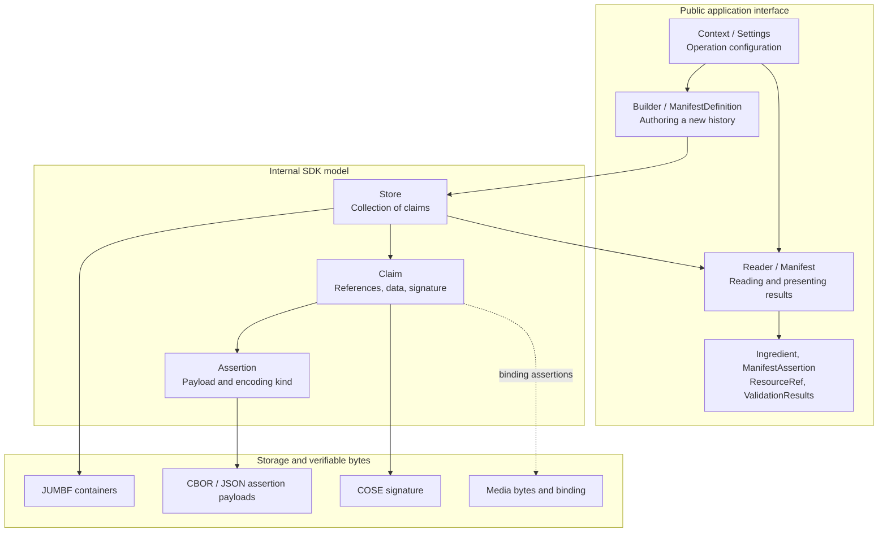

# c2pa-rs: The C2PA Model from Applications to Bytes

Inspected source snapshot: `main`, SHA `6c92bc322196b9b30be3599e62a363a63ab76b55`, prepared **31 October 2026**. Workspace version in [Cargo.toml](Cargo.toml): `0.92.0-dev`. This informative document explains this SDK; it does not introduce standard requirements or promise support for every feature of the latest specification. [Russian version](ONBOARDING.ru.md).

## Core Idea

An application works with media and its declared provenance. The SDK converts that history into assertions, associates it with the asset through a binding, constructs a claim and signature, saves a manifest store in a supported representation, and validates the connections when reading. Python, C and WASM integrations use this core but have their own interfaces and build constraints.

**The key distinctions when reading code: public `Manifest` is not internal `Claim`, a JSON report is not signed bytes, `ResourceRef` is not cryptographic proof, and successful parsing is not trusted provenance.**

## Three Layers

The public/internal boundary is visible in [sdk/src/lib.rs](sdk/src/lib.rs#L254). This diagram shows type responsibilities, not a complete object graph or exact CBOR layout.

`Store`, `Claim` and the general `Assertion` are not exported application types of this crate. Reading them helps explain the mechanics, but external code cannot substitute them for the public API. Structures in the public `assertions` module form another layer: typed payloads for particular assertions.

## First-Pass Vocabulary

| Concept | Meaning for onboarding | Start here |
|---|---|---|
| Asset | Media associated with the provenance history | [docs/usage.md](docs/usage.md) |
| Assertion | A declaration about provenance, an action, an ingredient or a binding | [sdk/src/assertions](sdk/src/assertions) |
| Claim | Internal manifest description with assertion references and related data | [sdk/src/claim.rs](sdk/src/claim.rs) |
| Manifest | A standard container; the public type with this name provides a convenient view | [sdk/src/manifest.rs](sdk/src/manifest.rs) |
| Manifest store | A collection of manifests, handled internally by `Store` | [sdk/src/store.rs](sdk/src/store.rs) |
| Ingredient | An asset used in producing the result; its relationship determines its role | [sdk/src/ingredient.rs](sdk/src/ingredient.rs) |
| Hard binding | A hash-based connection between provenance and asset content | [sdk/src/assertions](sdk/src/assertions) |
| Trust | Evaluation of the signer under a chosen policy, separate from manifest presence | [sdk/src/settings/mod.rs](sdk/src/settings/mod.rs) |

## First-Hour Route

1. Start with examples in [sdk/src/lib.rs](sdk/src/lib.rs#L31) and [docs/usage.md](docs/usage.md). The inputs include bytes/streams and MIME formats, not just JSON.
2. Read public exports in [sdk/src/lib.rs](sdk/src/lib.rs#L254), then [Builder](sdk/src/builder.rs) and [Reader](sdk/src/reader.rs). Separate authoring input from the read-side view.
3. Move one layer down: [Store](sdk/src/store.rs), [Claim](sdk/src/claim.rs), [Assertion](sdk/src/assertion.rs). Locate the conversion of application data into verifiable bytes.
4. Study ingredient lineage, hashed references, resources and validation results. Reading the entire crypto module is unnecessary initially.
5. Choose one integration scenario: ordinary file/stream, native FFI or fragmented video. Check APIs and feature flags on the agreed branch/SHA.

## Materials

| Document | Purpose | Suggested time |
|---|---|---|
| [Data model](docs/onboarding/MODEL.en.md) | Storage/views, integrity chain, ingredients and references | 15-20 minutes |
| [Type catalog](docs/onboarding/TYPES.en.md) | Fields, enums, owner modules, versions and common confusions | Reference alongside code |
| [Deep briefing](docs/onboarding/BRIEFING.en.md) | Write/read paths, validation policy, fragmented video and higher layers | 25-40 minute discussion |

These four English documents have matching Russian counterparts. Types and source links refer to the inspected local snapshot rather than a moving `latest` release.

## Trust Boundaries

Manifest presence, a correct signature, binding to the current asset, certificate trust and the truth of a depicted event are separate levels. Missing Content Credentials do not prove forgery; AI-related declarations are not a universal AI detector. Working resources and JSON views are not already-signed provenance.

The documents were prepared from local source. SDK and application builds were not performed for this onboarding; no code audit, conformance or release qualification is claimed. This repository's branch/version does not automatically match JS/Python package dependencies.