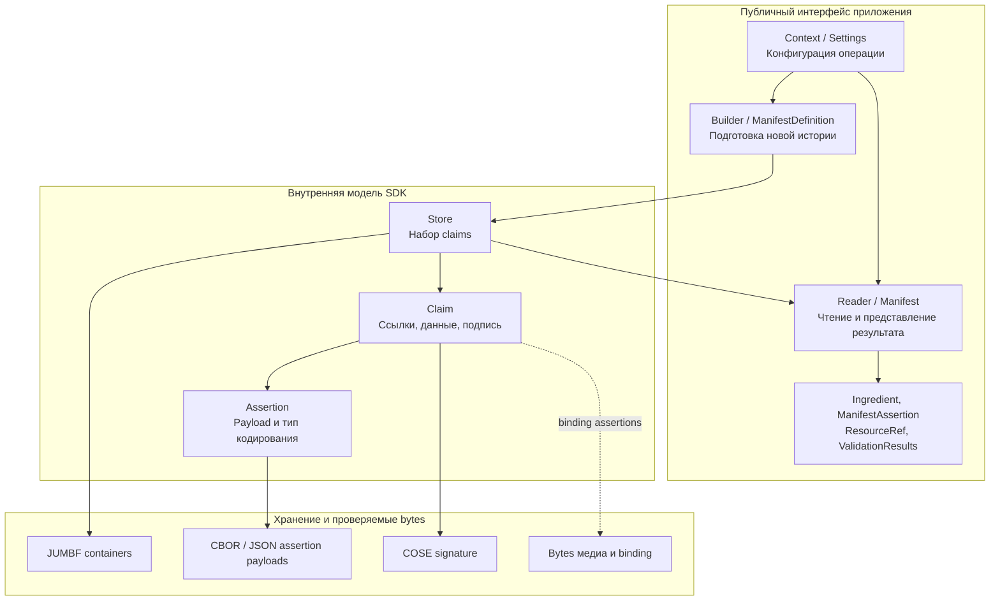

# c2pa-rs: модель C2PA от приложения до bytes

Исследованный локальный snapshot: `main`, SHA `6c92bc322196b9b30be3599e62a363a63ab76b55`, дата подготовки **31.10.2026**. Версия workspace по [Cargo.toml](Cargo.toml): `0.92.0-dev`. Документ информативный: объясняет этот SDK, а не задаёт новые требования стандарта и не обещает поддержку всех возможностей последней спецификации.

[English version](ONBOARDING.en.md).

## Главная идея

Приложение работает с медиа и историей его происхождения. SDK преобразует эту историю в assertions, связывает её с asset через binding, формирует claim и подпись, сохраняет manifest store в поддерживаемом представлении и при чтении проверяет связи. Python, C и WASM-интеграции используют это ядро, но имеют собственные интерфейсы и ограничения сборки.

**Самое важное для чтения кода: публичный `Manifest` не равен внутреннему `Claim`, JSON-отчёт не равен подписанным bytes, `ResourceRef` не равен криптографическому доказательству, а успешный parse не равен доверенному происхождению.**

## Три уровня

Граница public/internal подтверждена в [sdk/src/lib.rs](sdk/src/lib.rs#L254). Диаграмма показывает ответственность типов, не полный object graph и не точный layout CBOR.

`Store`, `Claim` и общий `Assertion` не являются экспортированными прикладными типами этого crate. Их читать полезно для понимания механики; использовать вместо публичного API снаружи crate нельзя. Структуры из публичного `assertions` module - другой уровень: typed payloads конкретных assertions.

## Словарь первого прохода

| Понятие | Значение для onboarding | Где начать |
|---|---|---|
| Asset | Медиа, с которым связывается история | [docs/usage.md](docs/usage.md) |
| Assertion | Отдельное утверждение о происхождении, действии, ingredient или binding | [sdk/src/assertions](sdk/src/assertions) |
| Claim | Внутреннее описание manifest со ссылками на assertions и связанными данными | [sdk/src/claim.rs](sdk/src/claim.rs) |
| Manifest | Контейнер стандарта; в public API одноимённый тип представляет удобный view | [sdk/src/manifest.rs](sdk/src/manifest.rs) |
| Manifest store | Набор manifests; в SDK за внутреннюю работу отвечает `Store` | [sdk/src/store.rs](sdk/src/store.rs) |
| Ingredient | Asset, участвовавший в создании результата; отношение определяет его роль | [sdk/src/ingredient.rs](sdk/src/ingredient.rs) |
| Hard binding | Хеш-связь истории с контентом asset | [sdk/src/assertions](sdk/src/assertions) |
| Trust | Оценка подписанта по выбранной policy, отдельно от наличия manifest | [sdk/src/settings/mod.rs](sdk/src/settings/mod.rs) |

## Маршрут на первый час

1. Начать с примеров в [sdk/src/lib.rs](sdk/src/lib.rs#L31) и [docs/usage.md](docs/usage.md). Зафиксировать, что на входе bytes/stream и MIME format, а не только JSON.
2. Прочитать public exports в [sdk/src/lib.rs](sdk/src/lib.rs#L254), затем определения [Builder](sdk/src/builder.rs) и [Reader](sdk/src/reader.rs). Разделить authoring input и read-side view.
3. Перейти на один уровень вниз: [Store](sdk/src/store.rs), [Claim](sdk/src/claim.rs), [Assertion](sdk/src/assertion.rs). Найти превращение прикладных данных в проверяемые bytes.
4. Разобрать ingredient lineage, hashed references, ресурсы и validation results. Чтение всего crypto module на старте не требуется.
5. Выбрать одну интеграционную задачу: обычный file/stream, native FFI или fragmented video. Проверить API и feature flags именно на согласованном branch/SHA.

## Набор материалов

| Документ | Для чего использовать | Рекомендуемое время |
|---|---|---|
| [Модель данных](docs/onboarding/MODEL.ru.md) | Storage/view, integrity chain, ingredients и references | 15-20 минут |
| [Каталог типов](docs/onboarding/TYPES.ru.md) | Поля, enums, owner modules, версии и типичные подмены | Справочник рядом с кодом |
| [Глубокая презентация](docs/onboarding/BRIEFING.ru.md) | Write/read paths, validation policy, fragmented video и высшие слои | 25-40 минут обсуждения |

Все четыре русских файла имеют английские counterparts. Типы и source links проверяются по локальному snapshot, а не по документации moving `latest` release.

## Границы доверия

Наличие manifest, корректная подпись, binding к текущему asset, доверие к сертификату и истинность изображённого события - разные уровни. Отсутствие Content Credentials не доказывает подделку; AI-related declarations не являются универсальным AI detector. Рабочие ресурсы и JSON-view не следует представлять как уже подписанную историю.

Документы подготовлены по исходникам локального snapshot. SDK и интеграционные приложения в рамках onboarding не собираются; code review, conformance и release qualification не заявляются. Branch/version этого репозитория не следует автоматически приравнивать к зависимостям JS/Python-пакетов.