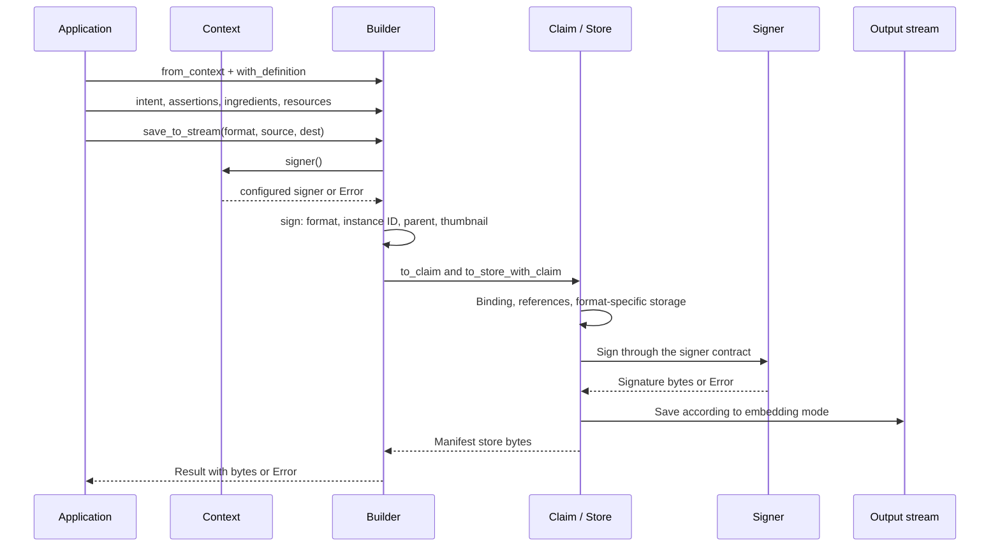
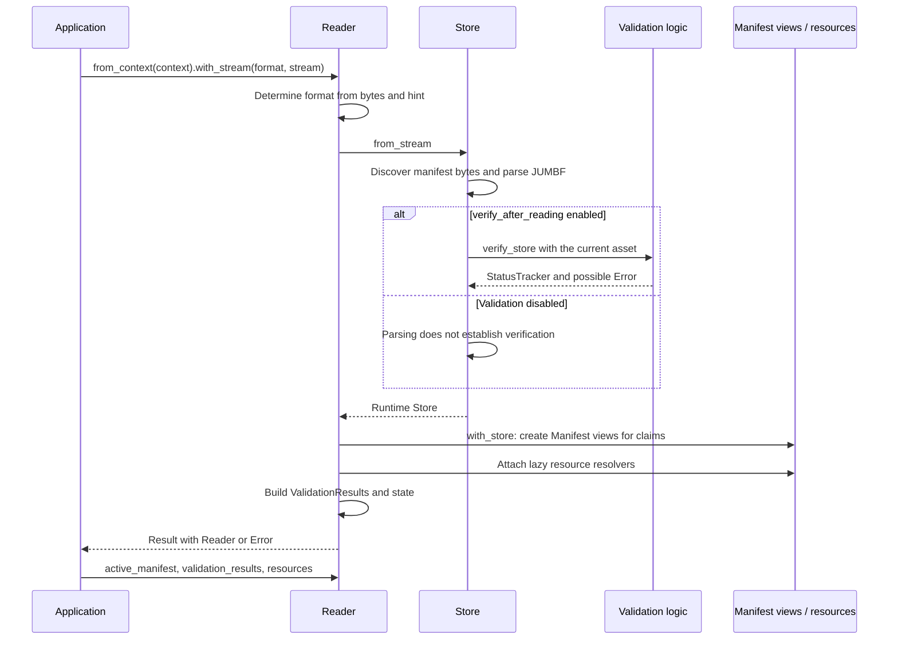
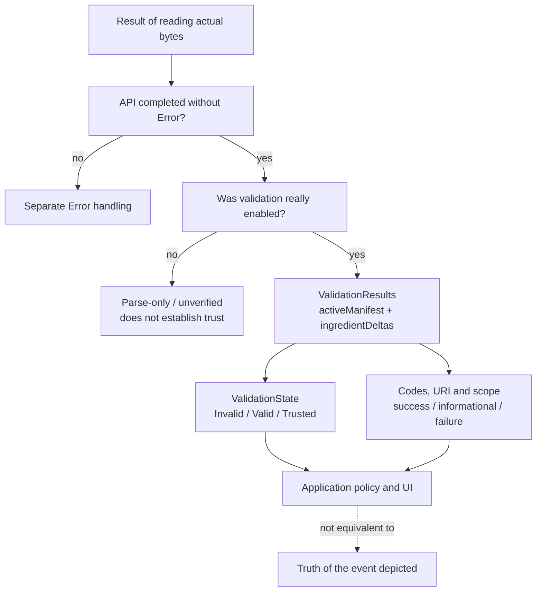
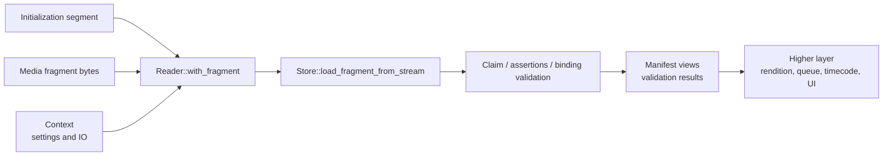
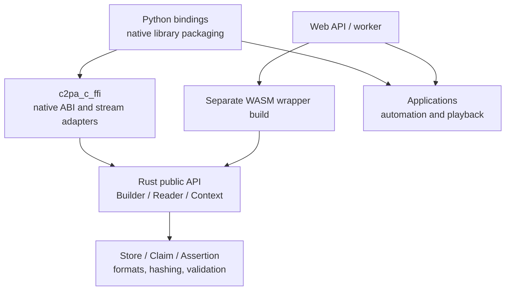

# The C2PA Model in Action: Deep Introductory Briefing

Ten discussion blocks for 25-40 minutes. Snapshot `6c92bc322196b9b30be3599e62a363a63ab76b55`, workspace `0.92.0-dev`, **31 October 2026**. Preparation: [model](MODEL.en.md); reference: [types](TYPES.en.md); entry point: [ONBOARDING.en.md](../../ONBOARDING.en.md). [Russian version](BRIEFING.ru.md).

This source-backed explanation describes the current SDK, not new normative requirements. Sequence diagrams abbreviate key operations rather than enumerate every optional timestamp, dynamic assertion, exception or format-specific branch.

## 1. The Model in Two Minutes

Assertions represent asset history. A claim associates them through hashed references and has a signature. A manifest stores claim, signature and payloads; the manifest store includes active provenance and ingredient manifests. The SDK simultaneously holds authoring input, runtime structures, encoded bytes and public read views.

**Team takeaway:** one logical history has several representations. Do not look for every field in one `Manifest`, treat arbitrary JSON as proof or copy runtime caches into wire schemas.

## 2. A Map for Different Team Roles

| Role | Main question | Start reading |
|---|---|---|
| Application developer | How do I read/add provenance? | Context, Reader, Builder |
| Integration developer | Which data and errors cross a boundary? | Public views, resources, C FFI / WASM contracts |
| SDK developer | Where do references, hashes and bytes originate? | Store, Claim, ClaimAssertion, Assertion |
| Format/video specialist | What is hash coverage and fragment API input? | Asset handlers, DataHash/BmffHash, init + fragment |
| UI/trust policy developer | What is valid, and whom do we trust? | ValidationResults, scopes, Context trust settings |

**Takeaway:** these roles use the same model but different slices of code. Reading all cryptography is unnecessary for the first integration experiment.

## 3. Write Path: New Signed Provenance

Verified anchors: [save_to_stream](../../sdk/src/builder.rs#L3315), [sign](../../sdk/src/builder.rs#L3214), [to_claim](../../sdk/src/builder.rs#L1620).

`save_to_stream` conveniently obtains the signer from Context; `sign` accepts it explicitly. Sync/async paths differ in signer and resolver contracts. Method documentation requires explicit async signer configuration.

**Builder constructs:** generator info, selected claim version, identifiers, ingredients, actions and resource links. **Format/core mechanics handle:** correct binding, storage and signing representations. Hashing order and details depend on format and signing mode; signing JSON alone does not reproduce them.

## 4. Source, Parent and Output

The source stream supplies bytes for a new signing operation's binding. A parent ingredient describes provenance from a preceding asset. Output reflects the selected embedding mode. These concepts can refer to different representations.

For Edit, the SDK can derive a parent from the source when none is separately provided. If an editing application already transformed media without retaining history in the rendition, prepare the parent ingredient from the actual preceding asset through a supported helper. Create/Update impose other constraints; do not habitually substitute Edit.

**Discussion question:** after an application exports a new MP4, which asset is the source stream and which is the parent? Does the application retain enough data to carry lineage forward?

## 5. Read Path: Byte Validation and View Construction

Anchors: [with_stream](../../sdk/src/reader.rs#L221), [Store::from_stream](../../sdk/src/store.rs#L3762), [validation gate](../../sdk/src/store.rs#L3861), [Reader::with_store](../../sdk/src/reader.rs#L1004).

Reader constructs `Arc<Store>`, public views and label lookup. Resources can resolve lazily: no eager copies does not mean no thumbnail, and a descriptor does not guarantee every fetch/read will succeed.

**Integration pitfall:** a call can return a Reader with non-severe validation findings. Check both `Result` and `validation_results()/validation_state()`. Conversely, a loading Error is not an ordinary success view with an invalid flag.

## 6. Validation, Trust and Policy

This is an integration decision tree, not normative check ordering. `ValidationResults::validation_state()` uses specific signature/validity/trust statuses and scopes. `Valid` does not guarantee `Trusted`; tolerated credential/CAWG failures can remain under `Valid`. `Trusted` additionally requires trust success and no considered failures.

**Reports need particular care:** [Reader::validation_state](../../sdk/src/reader.rs#L810) has a legacy fallback when `validation_results` is absent. A `from_json` result, default Reader or incomplete report is not fresh verification of the current asset. Record which API and settings actually performed validation.

### Relevant Flags in This Snapshot

Source: [Verify](../../sdk/src/settings/mod.rs#L557). These are source-documented defaults, not inspected effective settings of a particular application.

| Setting | Documented default | Significance |
|---|---|---|
| `verify_after_reading` | `true` | Parsing and verification differ; disabling this removes after-read checks |
| `verify_after_sign` | `false` | Signing success does not replace independent result validation |
| `verify_after_sign_hash` | `false`, internal field | Extra asset hash validation after signing; ineffective without the previous flag |
| `verify_trust` | `true`, internal field | Trust depends on selected anchors/config, not certificate presence alone |
| `verify_timestamp_trust` | `true`, internal field | Timestamp credential trust is separate from signer trust |
| `ocsp_fetch` | `false` | External revocation requests depend on settings and available data |

External Rust code cannot directly access `pub(crate)` fields; use supported Settings APIs/representations. Compile-time features and runtime flags are distinct conditions.

## 7. Fragmented Video: Same Model, Different Input

[with_fragment](../../sdk/src/reader.rs#L511) takes format, init stream and fragment stream. It is not `with_stream` with an arbitrary chunk of a full file. MIME/format hints do not convey all information needed to align init/rendition/offsets.

**What this diagram does not establish:** support for every new live/VSI feature in current `main`, or playback timestamps attached to claims themselves. HLS queues, retry, rendition switching and time-interval display typically belong above Rust SDK. Check newer fork-branch APIs and JS bundles at their exact SHAs; do not copy another release's API without verification.

## 8. Why Higher Layers Share the Fundamental Model

[c2pa_c_ffi/src/lib.rs](../../c2pa_c_ffi/src/lib.rs#L22) re-exports Builder/Reader/Signer and includes C API/stream adapters. Python uses a native library; the WASM wrapper lives in a separate JS repository. This describes architecture, not ABI layout or compatibility of all fork HEADs.

Wrappers preserve fundamental distinctions: typed payload/view/bytes, signer/trust policy, resource descriptor/content, Error/status. ABI/worker boundaries add their own ownership, lifecycle, serialization and delivery constraints. Shared Rust `Arc` is not a JavaScript or C memory contract.

## 9. First Practical Experiment Plan

This is a proposed plan, **not executed tests**. Use existing [sdk/tests/fixtures](../../sdk/tests/fixtures) and [sdk/examples](../../sdk/examples), not production credentials.

| Scenario | Observe | Explanatory layer |
|---|---|---|
| Read an existing signed asset | Active label, claims/views, results and trust settings | Reader + Store + ValidationResults |
| Read altered protected bytes | Binding/validation findings, not parsing alone | Hard binding and status scopes |
| Asset without a manifest | Selected API's error/absence path, not a forgery verdict | Discovery and API contract |
| Read under another trust policy | Changed trust findings/state with a preserved signature | Context/Settings and certificate policy |
| Sign with Edit intent | Parent ingredient and automatically associated actions | Builder authoring/model conversion |
| Retrieve a thumbnail | Descriptor, resolver and actual returned bytes | ResourceRef/ResourceStore |
| Fragment with aligned init | Format-specific results and errors | Fragment API + BMFF handling |

First record branch/SHA, features, settings, fixture and expected observation. Do not change them all simultaneously: otherwise the experiment cannot identify which model assumption it confirmed.

## 10. Onboarding Outcome and Next Layer

After the first pass, a developer should be able to explain:

- Where provenance becomes references and signed representations.
- Why public Manifest differs from Claim, and a JSON view from asset proof.
- Why parent and source do not always coincide.
- How signer, trust policy and IO/resolvers connect.
- Why validation results have state, codes and scopes.
- Which questions belong to the SDK versus higher-level wrappers/players.

Choose **one** follow-up path: Builder conversion/signing, Reader/validation, ingredient lineage/resources or BMFF/fragments. The next artifact is a source call map plus a reproducible fixture and scoped tests, not an immediate audit of all cryptography.

SDK builds, conformance and integration/runtime behavior were not verified in this documentation pass. Source-backed explanations and rendered diagrams do not replace those checks.