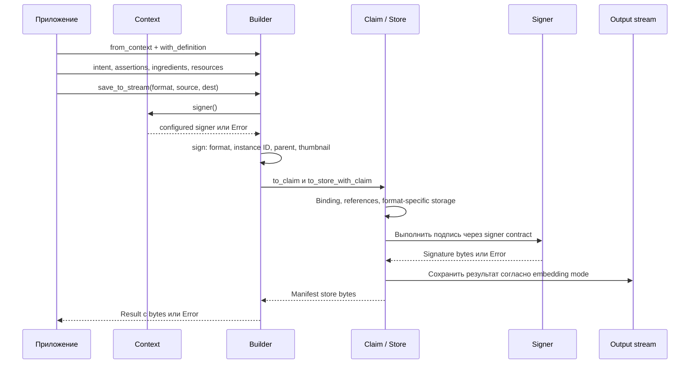
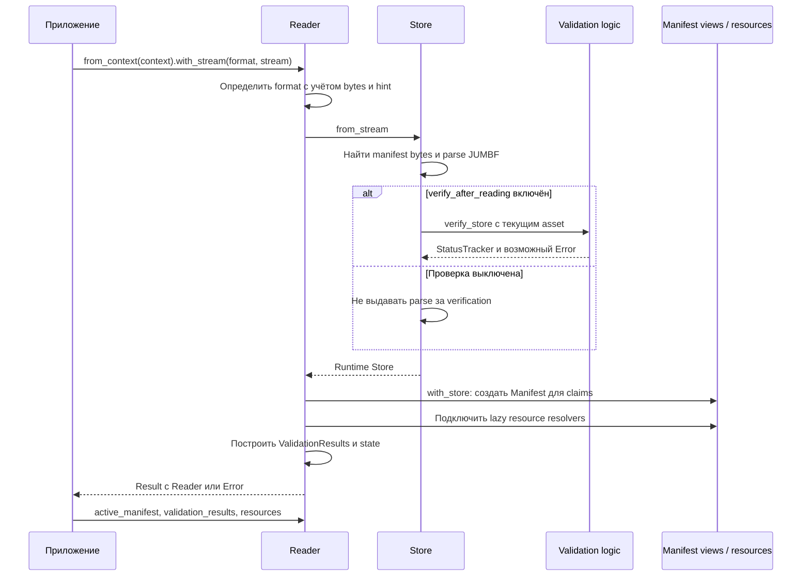
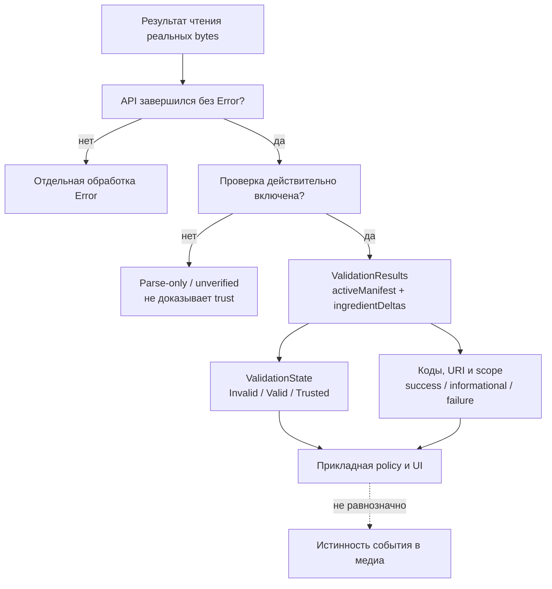
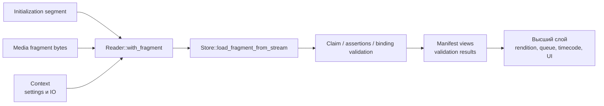
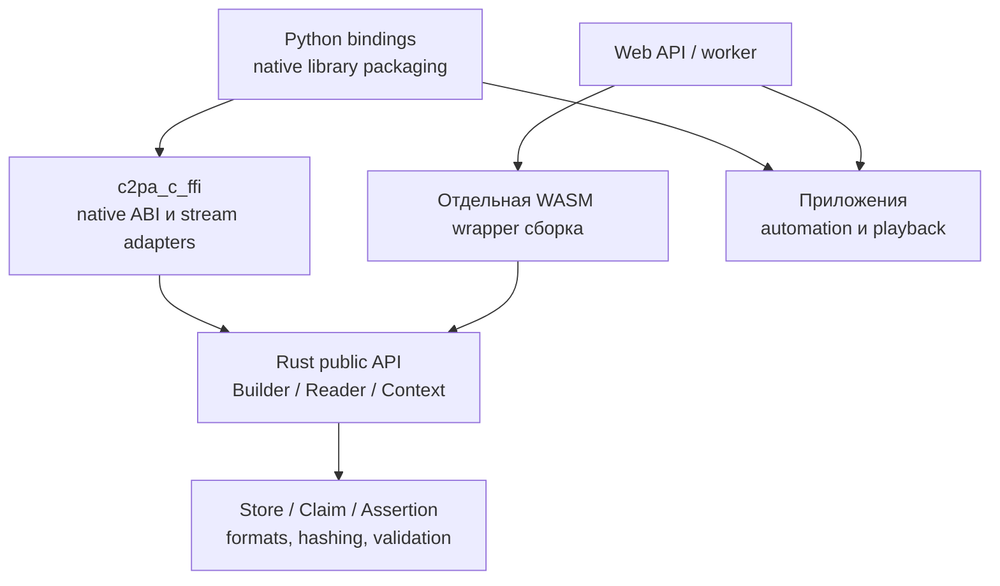

# Модель C2PA в действии: глубокая вводная презентация

Формат: десять блоков для обсуждения на 25-40 минут. Snapshot: `6c92bc322196b9b30be3599e62a363a63ab76b55`, workspace `0.92.0-dev`, **31.10.2026**. Предварительное чтение: [модель](MODEL.ru.md), справочник: [типы](TYPES.ru.md), вход: [ONBOARDING.ru.md](../../ONBOARDING.ru.md).

[English version](BRIEFING.en.md).

Это объяснение текущего SDK с source-backed переходами, не новая нормативная спецификация. Sequence diagrams сокращены до ключевых операций; они не перечисляют каждый optional timestamp, dynamic assertion, exception или format-specific branch.

## 1. Модель за две минуты

История asset представлена assertions. Claim связывает их через hashed references и имеет signature. Manifest хранит claim, signature и payloads; manifest store включает активную историю и manifests ingredients. SDK одновременно держит authoring input, runtime structures, encoded bytes и public read views.

**Тезис для команды:** над одной логической историей существуют разные representations. Не искать все поля в одном `Manifest`, не считать произвольный JSON доказательством и не переносить runtime caches в wire schema.

## 2. Карта для разных участников команды

| Участник | Основной вопрос | С чего читать |
|---|---|---|
| Разработчик приложения | Как прочитать/добавить provenance? | Context, Reader, Builder |
| Разработчик интеграции | Какие данные и errors передать через границу? | Public views, resources, C FFI / WASM contracts |
| Разработчик SDK | Где формируются references, hashes и bytes? | Store, Claim, ClaimAssertion, Assertion |
| Специалист по форматам/видео | Каков hash coverage и вход fragment API? | Asset handlers, DataHash/BmffHash, init + fragment |
| Разработчик UI/trust policy | Что валидно и кому доверяем? | ValidationResults, scopes, Context trust settings |

**Тезис:** эти роли используют одну модель, но им нужны разные срезы кода. Полное чтение crypto module не требуется для первого интеграционного эксперимента.

## 3. Write path: новая подписанная история

Проверенные anchors: [save_to_stream](../../sdk/src/builder.rs#L3315), [sign](../../sdk/src/builder.rs#L3214), [to_claim](../../sdk/src/builder.rs#L1620).

`save_to_stream` - удобный путь с signer из Context. `sign` позволяет передать signer явно. Sync и async paths различаются контрактами signer и resolver; для async signer по документации метода требуется явная конфигурация.

**Что формирует Builder:** generator info, выбранную claim version, identifiers, ingredients, actions и resource links. **Что остаётся format/core механике:** корректное binding/storage/signing representation. Порядок и особенности hashing зависят от формата и signing mode, не воспроизводятся простой «подписью JSON».

## 4. Source, parent и output

Source stream - bytes, на которые новая signing operation накладывает binding. Parent ingredient - происхождение из предыдущего asset. Output - результат сохранения по выбранному embedding mode. Эти три понятия могут описывать разные representations.

Для Edit SDK может получить parent из source, если parent не задан отдельно. Если editing application уже преобразовало медиа и не сохранило историю в rendition, parent ingredient следует подготовить из настоящего предыдущего asset через поддерживаемый helper. Create и Update имеют другие ограничения; не подменять их Edit по привычке.

**Вопрос для обсуждения:** если приложение экспортировало новый MP4, какой asset является source stream, а какой - parent? Достаточно ли у приложения данных, чтобы перенести lineage?

## 5. Read path: проверка bytes и построение views

Anchors: [with_stream](../../sdk/src/reader.rs#L221), [Store::from_stream](../../sdk/src/store.rs#L3762), [validation gate](../../sdk/src/store.rs#L3861), [Reader::with_store](../../sdk/src/reader.rs#L1004).

Reader создаёт `Arc<Store>`, public views и label lookup. Resources могут разрешаться лениво: отсутствие eager copies не означает отсутствия thumbnail, а presence descriptor не означает, что fetch/read всегда завершится успешно.

**Важная ошибка интеграции:** API call может вернуть Reader при non-severe validation findings. Поэтому проверять и `Result`, и `validation_results()/validation_state()`. И наоборот, Error на загрузке - не обычный success-view с флагом invalid.

## 6. Validation, trust и policy

Это дерево решений для интеграции, не нормативный порядок checks. `ValidationResults::validation_state()` использует конкретные signature/validity/trust statuses и scopes. `Valid` не гарантирует `Trusted`; tolerated credential/CAWG failures могут сохраняться при `Valid`. Для `Trusted` этот метод требует дополнительного trust success и отсутствия учитываемых failures.

**Особая осторожность с reports:** [Reader::validation_state](../../sdk/src/reader.rs#L810) имеет legacy fallback, если `validation_results` отсутствуют. Поэтому результат `from_json`, default Reader или неполный report не следует выдавать за новую verification текущего asset. Сохранять в системе факт того, каким API и settings выполнена проверка.

### Значимые flags этого snapshot

Источник: [Verify](../../sdk/src/settings/mod.rs#L557); values ниже - defaults, документированные в исходнике, не проверка фактических settings конкретного приложения.

| Setting | Документированный default | Почему важно |
|---|---|---|
| `verify_after_reading` | `true` | Parse и verification - разные операции; выключение убирает проверки после чтения |
| `verify_after_sign` | `false` | Signing success не заменяет независимую проверку результата |
| `verify_after_sign_hash` | `false`, internal field | Дополнительное asset hash validation после sign; не действует без предыдущего flag |
| `verify_trust` | `true`, internal field | Trust определяется выбранными anchors/config, не просто наличием сертификата |
| `verify_timestamp_trust` | `true`, internal field | Timestamp credential trust отдельный от signer trust |
| `ocsp_fetch` | `false` | Внешние запросы revocation зависят от settings и имеющихся данных |

`pub(crate)` fields не становятся доступными прямым Rust field access внешнему приложению; для настройки использовать поддерживаемый Settings API/representation. Наличие feature compile-time и runtime flag - разные условия.

## 7. Fragmented video: та же модель, другой вход

[with_fragment](../../sdk/src/reader.rs#L511) принимает format, init stream и fragment stream; это не `with_stream` с произвольным кусочком полного файла. MIME/format hint не передаёт все сведения, которые нужны для согласования init/rendition/offsets.

**Что не делает эта диаграмма:** не обещает поддержку каждой новой live/VSI-возможности в текущем `main` и не назначает playback timestamp самому claim. HLS fragment queue, retry, switching rendition и отображение time intervals обычно живут выше Rust SDK. API новых fork-веток и JS bundles проверяется на их точном SHA; не переносить сюда API другого release без проверки.

## 8. Почему высшие слои разделяют фундаментальную модель

В [c2pa_c_ffi/src/lib.rs](../../c2pa_c_ffi/src/lib.rs#L22) re-exported Builder/Reader/Signer и подключены C API/stream adapters. Python использует native library, а WASM wrapper находится в отдельном JS repository. Diagram описывает архитектуру, не ABI layout и не совместимость HEADs всех forks.

Обёртки не отменяют фундаментальные distinctions: typed payload/view/bytes, signer/trust policy, resource descriptor/content, Error/status. Но на границе ABI/worker добавляются собственные ownership, lifecycle, сериализация и delivery constraints. Shared Rust `Arc` не является контрактом памяти JavaScript или C.

## 9. План первого практического эксперимента

Ниже предложенный план, **не выполненные тесты**. Использовать существующие [sdk/tests/fixtures](../../sdk/tests/fixtures) и [sdk/examples](../../sdk/examples), не production credentials.

| Сценарий | Что наблюдать | Какой уровень объясняет результат |
|---|---|---|
| Read существующего подписанного asset | Active label, claims/views, results и trust settings | Reader + Store + ValidationResults |
| Read изменённых защищённых bytes | Binding/validation findings, не только parse | Hard binding и scope statuses |
| Asset без manifest | Error/absence path выбранного API; не объявлять forgery | Discovery и API contract |
| Read с другой trust policy | Изменение trust findings/state при сохранной подписи | Context/Settings и certificate policy |
| Sign с Edit intent | Parent ingredient и автоматически связанные actions | Builder authoring/model conversion |
| Получение thumbnail | Descriptor, resolver и фактически полученные bytes | ResourceRef/ResourceStore |
| Fragment с согласованным init | Format-specific результаты и ошибки | Fragment API + BMFF handling |

Сначала зафиксировать branch/SHA, features, settings, fixture и ожидаемое наблюдение. Не менять все одновременно: иначе невозможно понять, какую модель подтвердил эксперимент.

## 10. Результат onboarding и следующий уровень

После первого прохода разработчик должен уметь объяснить:

- Где история превращается в references и signed representation.
- Почему public Manifest отличается от Claim, а JSON-view - от asset proof.
- Почему parent и source не всегда совпадают.
- Как подключаются signer, trust policy и IO/resolvers.
- Почему validation results имеют state, codes и scopes.
- Какие вопросы относятся к SDK, а какие - к higher-level wrapper/player.

Для дальнейшего углубления выбрать **один** путь: Builder conversion/signing, Reader/validation, ingredient lineage/resources или BMFF/fragments. Артефакт следующего этапа - source call map плюс воспроизводимый fixture и scope tests, не сразу аудит всей криптографии.

Проверки SDK builds, conformance и integration/runtime behavior в этом документационном проходе не выполнены. Source-backed описание и render diagrams не заменяют эти проверки.