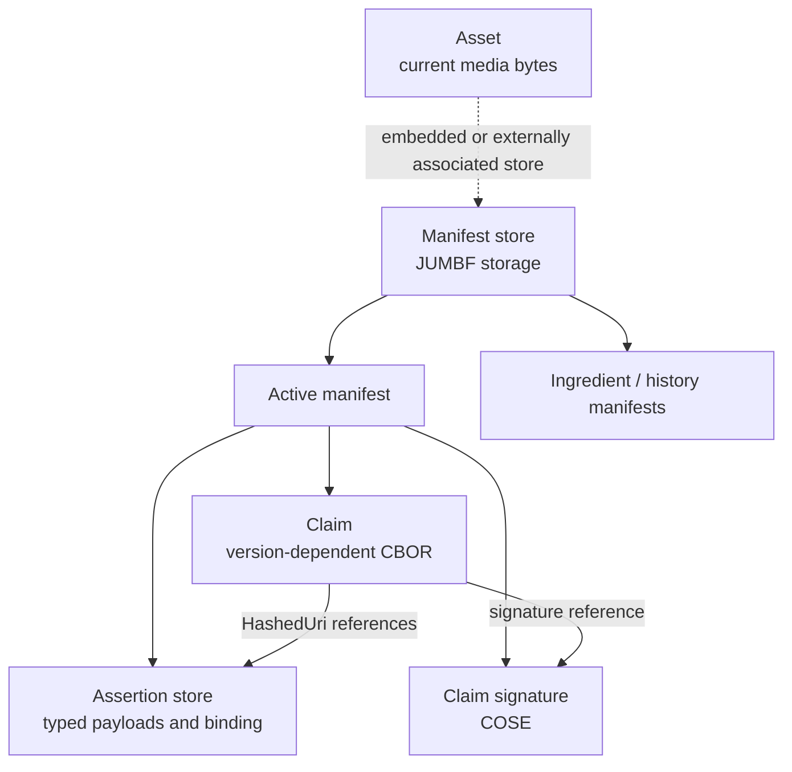
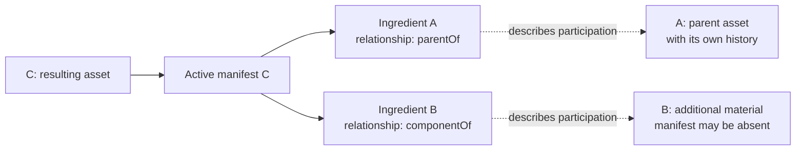
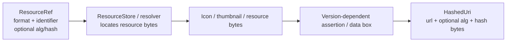

# Fundamental Model: History, Containers and Trust

Snapshot and reading route: [ONBOARDING.en.md](../../ONBOARDING.en.md). All source links refer to local SDK SHA `6c92bc322196b9b30be3599e62a363a63ab76b55`. Diagrams are conceptual: they do not replace standard CDDL or enumerate every optional box or legacy field. [Russian version](MODEL.ru.md).

## 1. What C2PA Stores

The asset is the current media bytes. Provenance is declared history: where material came from, which operations occurred and which software generated the claim. An assertion contains a part of that history or technical evidence of a connection. A manifest combines claim, signature and assertion storage. A manifest store combines multiple manifests, including ingredient history.

**A claim does not embed every assertion payload as a nested JSON object.** Its serialized assertion references use `HashedUri`. Payloads live in corresponding containers; signatures and hash references allow validation of the protected connections.

**External storage** can mean a sidecar or remote manifest; discovery depends on formats, settings and features. It does not justify applying a manifest from an arbitrary file to different bytes. [StoreValidationInfo](../../sdk/src/store.rs#L107) separately tracks `is_embedded` and `manifest_store_range`.

## 2. One Term, Several Representations

| Layer | SDK types | Representation |
|---|---|---|
| Authoring input | `Builder`, `ManifestDefinition` | Desired new provenance, working resources and intent |
| Runtime core | `Store`, `Claim`, `ClaimAssertion`, `Assertion` | Loaded/in-progress objects, references, bytes, caches and processing state |
| Wire/storage | JUMBF, CBOR claim, assertion payloads, COSE | Saved and verified representations |
| Read/report view | `Reader`, `Manifest`, `ManifestAssertion`, `SignatureInfo` | Application-facing data and report serialization |

In [Manifest](../../sdk/src/manifest.rs#L53), `signature_info` is explicitly reporting data. `resources`, signature bytes and assertion references are excluded from ordinary serde serialization. [Reader](../../sdk/src/reader.rs#L93) also marks internal `Arc<Store>` and `Arc<Context>` as `serde(skip)`.

Consequently, saving `Reader::json()` and later loading it as a report is not the same as supplying the original asset and manifest store for cryptographic validation. [Reader::from_json](../../sdk/src/reader.rs#L416) supports the view; proof does not reside in an arbitrary JSON report.

## 3. Runtime Claim Is Not the Claim CBOR Map

[Claim](../../sdk/src/claim.rs#L277) simultaneously stores:

- Identity and generator information, claim version and hash algorithm.
- `assertions`, `created_assertions` and `gathered_assertions` references.
- Runtime `assertion_store: Vec<ClaimAssertion>` and ingredient stores.
- A signature reference and separate signature bytes.
- Original bytes and box order where exact reading/validation requires them.
- Compression, remote/update flags and optional shared context.

[Serialize for Claim](../../sdk/src/claim.rs#L390) selects `serialize_v1` or `serialize_v2`. Do not copy every Rust field into CBOR, rename legacy fields or assume that a struct field is allowed in every schema version.

A manifest label identifies a container in the store. `ManifestDefinition.label` is an SDK input for choosing that label, not an instruction to add `"label"` to a standardized assertion payload. Assertion label, schema version and instance suffix are three further distinctions.

## 4. Integrity Chain

This explains protection layers, not the exact cryptographic operations of every algorithm. **Assertion hashes, asset binding hashes and signature algorithms are different.** Authoring `hash_alg` selects hashing; the signer separately reports `SigningAlg`.

Hard binding is not necessarily "SHA-256 of the entire file without exclusions." [DataHash](../../sdk/src/assertions/data_hash.rs) accounts for ranges; [BmffHash](../../sdk/src/assertions/bmff_hash.rs) for BMFF structure and associated rules; [BoxHash](../../sdk/src/assertions/box_hash.rs) for a box-based approach. Exclusion validation prevents unrelated content from being excluded along with manifest bytes.

Soft binding addresses another problem: association/discovery through content properties surviving some transformations. It does not replace hard binding, signer trust or validation of the current asset. Start at [soft_binding.rs](../../sdk/src/assertions/soft_binding.rs).

## 5. Ingredients Form a Graph, Not Just a File List

Public `Ingredient` describes an asset used to create the current one. `parentOf` identifies the parent asset; `componentOf` identifies incorporated material. An ingredient can have its own manifest store or lack C2PA data. Its complete source bytes do not necessarily appear in the resulting store.

Arrows represent references from the result to its inputs, not file movement. History can share subgraphs; traversing it as a tree without repeated-reference handling is unsafe. Internal Store checks ingredient depth and keeps validation mappings; this is defensive SDK behavior, not a new universal standard limit.

**Source stream and parent asset can differ.** The source stream supplies bytes for the new operation's binding; a parent ingredient can describe an earlier asset from which the application already produced an edited rendition. See [docs/usage.md](../usage.md).

## 6. Public Ingredient and Wire Ingredient Are Different Types

[sdk/src/ingredient.rs](../../sdk/src/ingredient.rs#L63) defines exported `c2pa::Ingredient` for Builder/Reader. [sdk/src/assertions/ingredient.rs](../../sdk/src/assertions/ingredient.rs) defines payload `c2pa::assertions::Ingredient`, which becomes an assertion.

The public view holds labels, resource references, manifest data and reading results. [Builder::to_claim](../../sdk/src/builder.rs#L1620) converts ingredients through `add_to_claim`, history imports and references; generator icons and thumbnails also acquire their corresponding wire representations.

Do not equate public-view `active_manifest: Option<String>` with the serialized type of a versioned ingredient payload. Choose the payload type and version for schema work, not copied read-side JSON fields.

## 7. Working Resources and Hashed References

[ResourceRef](../../sdk/src/resource_store.rs#L119) is an application resource descriptor. Its identifier can be a JUMBF URI, file path, URL or working key. An optional hash does not make every `ResourceRef` automatically validated. Runtime resource resolvers and filesystem containment are not configuration to trust from an input manifest.

[HashedUri](../../sdk/src/hashed_uri.rs#L29) stores the hash as `Vec<u8>` with `serde_bytes`. Salt exists in the runtime type but is excluded from HashedUri serialization. [UriOrResource::to_hashed_uri](../../sdk/src/resource_store.rs#L53) shows a specific conversion: v1 uses a data box; newer claims use the corresponding embedded assertion for this resource. This is not a universal rule for all payloads.

## 8. Validation Results Have Scope

[ValidationResults](../../sdk/src/validation_results.rs#L115) groups `activeManifest` statuses and `ingredientDeltas`. Groups distinguish success, informational and failure. Reader also exposes overall `ValidationState` and legacy flat statuses.

**Do not simplify this to "any failure means everything is forged."** [validation_state](../../sdk/src/validation_results.rs#L348) considers signature, validity, trust and failure scope. Some credential/CAWG failures are tolerated for `Valid`, but remain visible and do not imply `Trusted`. This describes current SDK behavior, not advice to ignore failures.

For UI/services, preserve state, code, target URI and ingredient scope. Distinguish inability to read/validate, missing manifests, binding failures and an untrusted signer. None independently establishes whether an event depicted in media is true.

## Self-Check Questions

1. Which bytes are signed/hashed, and which only serve a JSON view?
2. Where is the schema version determined: payload, label or selected claim version?
3. Is there a parent ingredient, and is the source stream the same asset?
4. What does `ResourceRef.identifier` identify, and who resolves it to bytes?
5. Was the binding checked against the current asset, and which trust policy applied?
6. Does a failure concern the active manifest, an ingredient or an identity assertion?