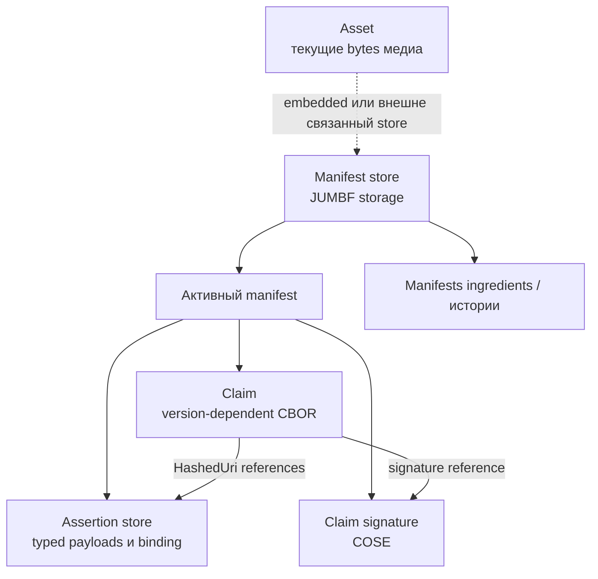
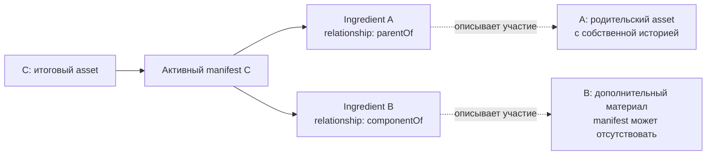
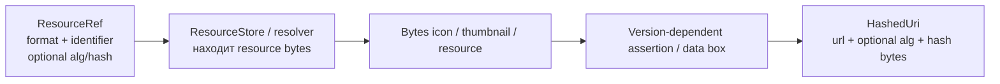

# Фундаментальная модель: история, контейнеры и доверие

Snapshot и маршрут чтения: [ONBOARDING.ru.md](../../ONBOARDING.ru.md). Все ссылки относятся к локальному SDK на SHA `6c92bc322196b9b30be3599e62a363a63ab76b55`. Диаграммы концептуальные: они не заменяют CDDL стандарта и не перечисляют каждый optional box или legacy field.

[English version](MODEL.en.md).

## 1. Что именно хранит C2PA

Asset - текущие bytes медиа. Provenance - заявленная история: откуда пришёл материал, какие операции выполнены и каким software сформирован claim. Assertion содержит отдельную часть этой истории или техническое доказательство связи. Manifest объединяет claim, signature и assertion storage. Manifest store объединяет несколько manifests, в том числе историю ingredients.

**Claim не содержит все assertion payloads как вложенные JSON objects.** Его сериализуемые ссылки на assertions используют `HashedUri`. Payloads находятся в соответствующих контейнерах; подпись и hash references позволяют обнаруживать нарушение проверяемых связей.

**Внешнее хранение** может означать sidecar или remote manifest; конкретные способы обнаружения зависят от формата, settings и features. Это не повод применять manifest от произвольного файла к другим bytes. В [StoreValidationInfo](../../sdk/src/store.rs#L107) отдельно учитываются `is_embedded` и `manifest_store_range`.

## 2. Один термин - несколько представлений

| Уровень | Типы SDK | Что представляют |
|---|---|---|
| Authoring input | `Builder`, `ManifestDefinition` | Что приложение хочет включить в новую историю, плюс рабочие ресурсы и intent |
| Runtime core | `Store`, `Claim`, `ClaimAssertion`, `Assertion` | Загруженные/строящиеся объекты, ссылки, bytes, caches и состояние обработки |
| Wire/storage | JUMBF, CBOR claim, assertion payloads, COSE | Фактически сохраняемые и проверяемые representations |
| Read/report view | `Reader`, `Manifest`, `ManifestAssertion`, `SignatureInfo` | Данные, удобные приложению и сериализации отчётов |

В [Manifest](../../sdk/src/manifest.rs#L53) `signature_info` прямо помечено как reporting data. `resources`, signature bytes и assertion references исключаются из обычной serde-сериализации. В [Reader](../../sdk/src/reader.rs#L93) внутренний `Arc<Store>` и `Arc<Context>` тоже `serde(skip)`.

Следствие: сохранить `Reader::json()` и позднее загрузить его как report - не то же самое, что передать исходный asset и manifest store для криптографической проверки. [Reader::from_json](../../sdk/src/reader.rs#L416) существует для представления; proof находится не в произвольном JSON-отчёте.

## 3. Claim runtime не равен claim CBOR map

[Claim](../../sdk/src/claim.rs#L277) хранит одновременно:

- Идентификацию и generator info, claim version и hash algorithm.
- References `assertions`, `created_assertions`, `gathered_assertions`.
- Runtime `assertion_store: Vec<ClaimAssertion>` и stores ingredients.
- Signature reference и отдельные signature bytes.
- Исходные bytes и порядок boxes, когда они нужны для точного чтения/проверки.
- Compression, remote/update flags и optional shared context.

[Serialize for Claim](../../sdk/src/claim.rs#L390) выбирает `serialize_v1` или `serialize_v2`. Не переносить все Rust field names в CBOR, не переименовывать legacy fields и не считать наличие поля в struct доказательством, что оно разрешено в любой версии схемы.

Manifest label идентифицирует контейнер в store. `ManifestDefinition.label` - параметр SDK для выбора label; это не инструкция добавлять `"label"` в стандартизованный assertion payload. Assertion label, его schema version и instance suffix - ещё три отдельные вещи.

## 4. Цепочка целостности

```mermaid
flowchart LR
    Cert["Signing credential<br/>и trust policy"]
    Sig["COSE signature"]
    Claim["Сериализованные claim bytes"]
    Ref["HashedUri<br/>url + alg + hash"]
    Payload["Assertion representation"]
    Binding["Hard binding assertion"]
    Asset["Соответствующий контент asset"]
    Cert -. "проверка доверия отдельно" .-> Sig
    Sig -->|"защищает claim"| Claim
    Claim --> Ref
    Ref -->|"проверяемая ссылка"| Payload
    Payload --> Binding
    Binding -->|"format-specific hash coverage"| Asset
```

Схема объясняет уровни защиты, а не описывает точные криптографические операции всех algorithms. **Assertion hash, asset binding hash и signature algorithm - не одно и то же.** В authoring `hash_alg` выбирает hashing; signer сообщает `SigningAlg` отдельно.

Hard binding не обязательно означает «SHA-256 от всего файла без исключений». [DataHash](../../sdk/src/assertions/data_hash.rs) учитывает ranges; [BmffHash](../../sdk/src/assertions/bmff_hash.rs) - структуру BMFF и соответствующие правила; [BoxHash](../../sdk/src/assertions/box_hash.rs) - box-based подход. Проверка исключений важна, чтобы вместе с manifest bytes не исключить из проверки посторонний контент.

Soft binding - другая задача: привязка/поиск по свойствам контента, переживающим некоторые преобразования. Оно не заменяет hard binding, signer trust и проверку текущего asset. Точка входа: [soft_binding.rs](../../sdk/src/assertions/soft_binding.rs).

## 5. Ingredients создают граф, не просто список файлов

Public `Ingredient` описывает asset, использованный при создании текущего. `parentOf` обозначает родительский asset, `componentOf` - включённый материал. Ingredient может иметь собственный manifest store, а может быть без C2PA данных; сами исходные bytes не обязаны целиком встраиваться в итоговый store.

Стрелки в этой диаграмме обозначают references от результата к его входам, не направление движения файла. История может иметь общие подграфы; не обходить её как дерево без контроля повторных ссылок. Внутренний Store проверяет ingredient depth и хранит mappings для validation; это защитная механика SDK, не универсальный новый лимит стандарта.

**Source stream и parent asset могут различаться.** Source stream - bytes, на которые новая операция подписи накладывает binding; parent ingredient может описывать другой asset, из которого приложение уже произвело изменённую rendition. Эта граница объяснена в [docs/usage.md](../usage.md).

## 6. Public Ingredient и wire Ingredient - разные типы

[sdk/src/ingredient.rs](../../sdk/src/ingredient.rs#L63) определяет экспортируемый `c2pa::Ingredient`, удобный Builder/Reader. [sdk/src/assertions/ingredient.rs](../../sdk/src/assertions/ingredient.rs) определяет payload `c2pa::assertions::Ingredient`, который попадает в assertion.

Public view содержит labels, resource references, manifest data и результаты чтения. При [Builder::to_claim](../../sdk/src/builder.rs#L1620) ingredients преобразуются через `add_to_claim`, imports истории и references; generator icons и thumbnails тоже получают соответствующее wire representation.

Не считать `active_manifest: Option<String>` в public view тем же serialized field type, что в versioned ingredient payload. Для схемы выбирать payload type и версию, а не копировать поля read-side JSON.

## 7. Рабочие ресурсы и hashed references

[ResourceRef](../../sdk/src/resource_store.rs#L119) - descriptor ресурса в прикладной модели. Его identifier может быть JUMBF URI, file path, URL или рабочим key. Optional hash не означает, что любой `ResourceRef` автоматически проверен. Runtime resource resolver и filesystem containment не являются данными, которым следует доверять из входного manifest.

[HashedUri](../../sdk/src/hashed_uri.rs#L29) хранит hash как `Vec<u8>` с `serde_bytes`. Salt есть в runtime type, но исключён из сериализации HashedUri. [UriOrResource::to_hashed_uri](../../sdk/src/resource_store.rs#L53) показывает конкретный переход: v1 использует data box, более новые claims - соответствующую embedded assertion для этого ресурса. Это не общее правило для всех payloads.

## 8. Валидация - результат с областью действия

[ValidationResults](../../sdk/src/validation_results.rs#L115) группирует `activeManifest` statuses и `ingredientDeltas`. Группы разделяют success, informational и failure. Reader также возвращает общий `ValidationState` и legacy flat statuses.

**Не сводить результат к «есть failure → всё поддельное».** [validation_state](../../sdk/src/validation_results.rs#L348) учитывает подпись, её validity, trust и scope failures; некоторые credential/CAWG failures допускаются для состояния `Valid`, но остаются видимыми и не равны `Trusted`. Это поведение текущего SDK, не совет игнорировать failures.

Для UI/сервиса сохранять state, код, target URI и ingredient scope. Отличать невозможность прочитать/проверить данные, отсутствие manifest, нарушение binding и отсутствие доверенного подписанта. Никакое из этих состояний само по себе не устанавливает истинность события в кадре.

## Вопросы самопроверки

1. Какие bytes подписаны/хешируются, а какие служат JSON-view?
2. Где определяется schema version: в payload, label или выбранном claim version?
3. Есть ли parent ingredient и является ли source stream тем же asset?
4. Что обозначает `ResourceRef.identifier` и кто разрешает его в bytes?
5. Проверен ли binding к текущему asset и какая trust policy применена?
6. Какой scope у failure: активный manifest, ingredient или identity assertion?