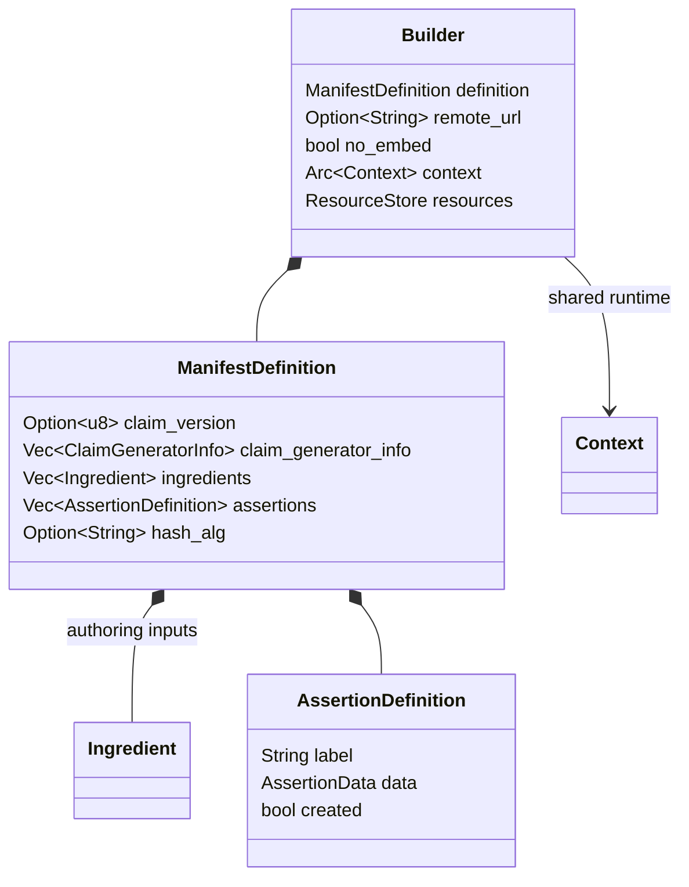
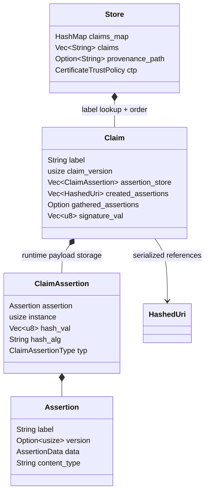
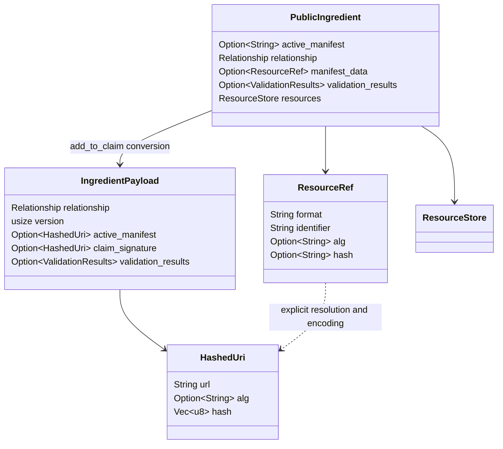
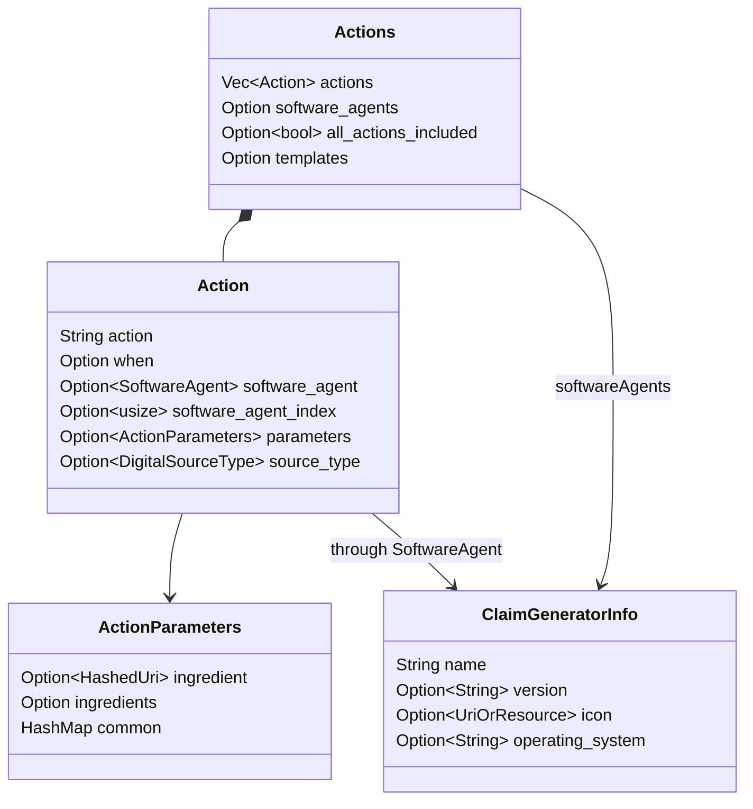
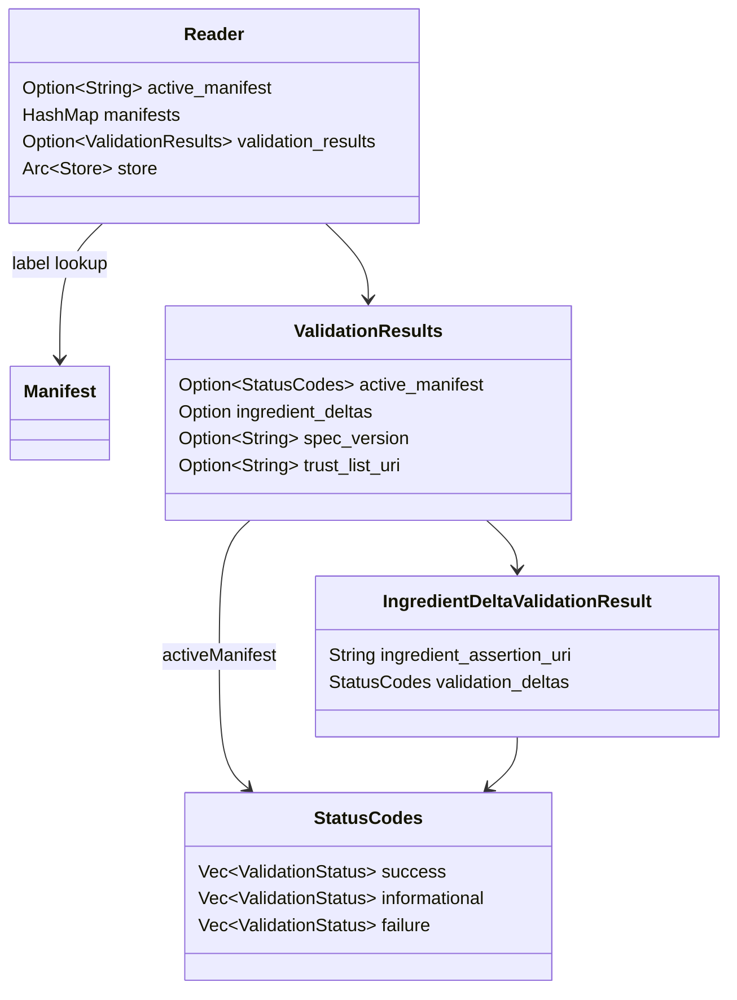

# Type Catalog: A Reading Guide to the SDK

Foundation: [C2PA model](MODEL.en.md); entry point: [ONBOARDING.en.md](../../ONBOARDING.en.md). Snapshot SHA `6c92bc322196b9b30be3599e62a363a63ab76b55`, workspace `0.92.0-dev`. Names and key fields refer to this snapshot; diagrams are abbreviated, not full Rust declarations or wire schemas. [Russian version](TYPES.ru.md).

## 1. Public API and Authoring Input

`Builder`, `ManifestDefinition`, `BuilderIntent` and `HashType` are root-crate exports. `AssertionDefinition` and authoring `AssertionData` are defined in the private `builder` module and are not root re-exports. Appearing as field types does not make them directly nameable by external Rust code. JSON/`with_definition` and Builder methods provide the simpler supported entry points.

### ManifestDefinition Fields

Source: [builder.rs](../../sdk/src/builder.rs#L118).

| Fields | Rust type | Purpose |
|---|---|---|
| `claim_version` | `Option<u8>` | Claim version; the SDK defaults to building v2 |
| `vendor`, `label` | `Option<String>` | Manifest label inputs, not assertion payload fields |
| `claim_generator_info` | `Vec<ClaimGeneratorInfo>` | Software identity; empty input resolves through settings/defaults during build |
| `title` | `Option<String>` | Display name, not a cryptographic identifier |
| `format` | `String` | MIME; definition deserialization defaults to `application/octet-stream` |
| `instance_id` | `String` | Asset instance identifier; generated default `xmp.iid:...` |
| `thumbnail` | `Option<ResourceRef>` | Working resource reference for subsequent conversion |
| `ingredients` | `Vec<Ingredient>` | Public ingredient objects participating in the new history |
| `assertions` | `Vec<AssertionDefinition>` | Authoring assertions, not yet claim references |
| `redactions` | `Option<Vec<String>>` | JUMBF URIs of selected assertions in ingredient manifests |
| `metadata` | `Option<Vec<AssertionMetadata>>` | Legacy/not-recommended metadata path according to SDK comments |
| `hash_alg` | `Option<String>` | Default claim/assertion/asset hashing, not the signer algorithm |

These are input fields, not permissions for every C2PA version. Title/format can appear in authoring views even when the claim wire map uses a different structure.

### BuilderIntent and HashType

Sources: [BuilderIntent](../../sdk/src/builder.rs#L352), [HashType](../../sdk/src/builder.rs#L72).

| Enum | Variants | Usage model |
|---|---|---|
| `BuilderIntent` | `Create(DigitalSourceType)`, `Edit`, `Update` | New creation, parent editing, restricted updates without changing hashed content |
| `HashType` | `Data`, `Bmff`, `Box` | Embeddable hard-binding mechanics, not signature algorithm kind |

Create does not imply a parent ingredient. Edit requires a parent and can derive it from the source stream. Update imposes additional restrictions. Builder performs checks and inserts automatic actions. This is not Rust typestate: `set_intent` changes a runtime field rather than making invalid input impossible at compile time.

## 2. Runtime Store / Claim / Assertion

Sources: [Store](../../sdk/src/store.rs#L123), [Claim](../../sdk/src/claim.rs#L277), [ClaimAssertion](../../sdk/src/claim.rs#L151), [Assertion](../../sdk/src/assertion.rs#L226). Their owner modules are private in the root crate; an internal `pub struct` does not make the type public to external consumers.

- `Store.claims_map` supports label lookup and `claims` preserves order. Box/signature hash caches, trust policy and provenance path are runtime state, not a JSON map of all standard fields.
- `Claim.assertion_store` contains payload objects and hash bookkeeping; serialized claim references are separate lists. `Claim.original_bytes` supports using original representations instead of reconstructed JSON views.
- `ClaimAssertion.instance` distinguishes repeated assertion labels; `typ` takes `V1`, `Gathered`, `Created`. `hash_val` and `hash_alg` concern assertion references, not the signature signer.
- `Assertion` holds encoded payload, label, version and content type. It is an SDK envelope; the label is not automatically a field of the standardized payload.

## 3. Three Easily Confused Data Representations

| Type and owner | Variants | Data stage |
|---|---|---|
| `builder::AssertionData` | `Cbor(c2pa_cbor::Value)`, `Json(serde_json::Value)` | Authoring: structured values before encoding |
| `assertion::AssertionData` | `Json(String)`, `Binary(Vec<u8>)`, `Cbor(Vec<u8>)`, `Uuid(String, Vec<u8>)` | Core: encoded payload and bytes |
| `manifest_assertion::ManifestData` | `Json(Value)`, `Cbor(CborValue)`, `Binary(Vec<u8>)` | Read/report view; access methods depend on representation |

Sources: [authoring data](../../sdk/src/builder.rs#L235), [encoded data](../../sdk/src/assertion.rs#L183), [view data](../../sdk/src/manifest_assertion.rs#L27).

`AssertionDefinition` holds `label`, `data`, optional `kind` and `created`. Input JSON without explicit `kind` becomes a CBOR value. `ManifestAssertionKind` has `Cbor`, `Json`, `Binary`, `Uri`, but the authoring JSON deserializer for `AssertionDefinition` allows Cbor/Json and rejects the other branches. Four enum variants do not mean four assertion-input mechanisms through every API.

[ManifestAssertion](../../sdk/src/manifest_assertion.rs#L37) is a public labeled view: `label()`, `label_with_instance()`, `instance()`, `kind()`, `created()`, `value()`, `binary()`, `to_assertion<T>()`. `value()` can return `UnsupportedType` when data is not a JSON view. `created` means attribution to the signer, not "validated" or "trusted."

## 4. Ingredient and Resource References

`PublicIngredient`/`IngredientPayload` are **diagram-only aliases**, not new Rust types. Actual names: [c2pa::Ingredient](../../sdk/src/ingredient.rs#L63), [c2pa::assertions::Ingredient](../../sdk/src/assertions/ingredient.rs#L65).

Public Ingredient includes title/format, identifiers, relationship, source type, thumbnail/data/manifest_data references, validation status/results and a resource store. The payload contains versioned hashed references and uses `serialize_v1/v2/v3`. In the v3 wire payload type, `active_manifest` and `claim_signature` are `Option<HashedUri>`; public-view active manifest is a label string. These are different representations, not a type conflict.

`Relationship`: `ParentOf` -> `parentOf`, `ComponentOf` -> `componentOf` (default), `InputTo` -> `inputTo`. Values describe ingredient roles relative to the result. Distinguish Rust enum spelling from serialized strings, and do not call every ingredient a parent.

`ResourceRef` has `format`, `identifier`, optional `data_types`, `alg`, `hash`; its hash is `Option<String>`. `HashedUri` has `url`, optional `alg` and hash `Vec<u8>`; runtime salt is not serialized. `ResourceStore` holds bytes and an optional lazy resolver; file I/O accounts for a base path and runtime containment root. These mechanisms do not independently validate provenance.

Sources: [resource_store.rs](../../sdk/src/resource_store.rs#L119), [hashed_uri.rs](../../sdk/src/hashed_uri.rs#L29).

## 5. Typed Payloads: Actions and Software Identity

Sources: [Action](../../sdk/src/assertions/actions.rs#L486), [Actions](../../sdk/src/assertions/actions.rs#L959), [ClaimGeneratorInfo](../../sdk/src/claim_generator_info.rs#L28).

`Action.action` is an operation label; `Actions` is an assertion containing operations. Optional `when`, agent, changed regions, parameters, related actions and reason provide detail. A list does not imply complete history: `all_actions_included` is a separate declaration whose absence does not mean `true`.

SDK `SoftwareAgent` can be `String` or `ClaimGeneratorInfo`; both variants do not override restrictions of a particular actions schema version. Action parameters differ across v1/v2, including `ingredient`/`ingredients`. Do not put descriptions in a legacy nested field without checking the target representation.

`ClaimGeneratorInfo` also includes `spec_version` and an extension map. This is a declared generator description, not certificate identity or proof that a product actually performed an operation. `DigitalSourceType` describes a declared source category, such as digital capture, not an independent classifier result.

### Typed Assertion Families

| Family | Main types / source | Why read it |
|---|---|---|
| History | [Action, Actions](../../sdk/src/assertions/actions.rs) | Operations, agents and ingredient references |
| Participants | [Ingredient, Relationship](../../sdk/src/assertions/ingredient.rs) | Lineage and versioned links |
| Integrity | [DataHash](../../sdk/src/assertions/data_hash.rs), [BmffHash](../../sdk/src/assertions/bmff_hash.rs), [BoxHash](../../sdk/src/assertions/box_hash.rs) | Bytes/ranges, box structure and Merkle-related BMFF data |
| Discovery/resilient association | [soft_binding.rs](../../sdk/src/assertions/soft_binding.rs) | Soft binding, not a substitute for hard validation |
| Resources and metadata | [embedded_data.rs](../../sdk/src/assertions/embedded_data.rs), [metadata.rs](../../sdk/src/assertions/metadata.rs), [assertion_metadata.rs](../../sdk/src/assertions/assertion_metadata.rs) | Binary content and additional descriptions |
| Time/certificates | [timestamp.rs](../../sdk/src/assertions/timestamp.rs), [certificate_status.rs](../../sdk/src/assertions/certificate_status.rs) | Supporting validation data |

`AssertionBase` defines label/version and conversion; CBOR/JSON helpers encode typed structs. Common traits live in private [assertion.rs](../../sdk/src/assertion.rs#L103); concrete public payload types are available through `assertions`.

### Binding Fields and Runtime State

`DataHash` contains `exclusions: Option<Vec<HashRange>>`, optional `name`/`alg`, hash/padding bytes; `path` is excluded from serde. `BmffHash` holds exclusions, optional alg/hash/name and Merkle maps. Insertion points, cached UUID boxes and internal version are runtime state, not a complete wire map.

Do not calculate binding from this abbreviated table: format, exclusions and placeholder/signing flows affect byte coverage. `HashType::Bmff` does not imply support for every segment of every live protocol at this SHA.

## 6. Context, Settings and Signer

[Context](../../sdk/src/context.rs#L269) holds Settings, sync/async resolver state, signer state, progress callback, cancellation flag and IO handler registry. Builder/Reader can share `Arc<Context>`. This is runtime configuration, not signed asset metadata.

[Signer](../../sdk/src/signer.rs#L49) provides `sign(data)`, `alg()`, `certs()`, `reserve_size()` and optional timestamp/OCSP/dynamic assertion hooks. [AsyncSigner](../../sdk/src/signer.rs#L162) is a separate async contract. Signer supplies signing mechanics; Reader's trust policy answers a different question: whether to trust a validated credential.

`SigningAlg` is re-exported from a crypto dependency; public Manifest `SignatureInfo` is a reporting summary. Do not confuse `reserve_size` with asset hash length; the reserve supports placing the signature representation during build/embedding.

## 7. Read-Side Types and Validation

Sources: [Reader](../../sdk/src/reader.rs#L93), [Manifest](../../sdk/src/manifest.rs#L53), [ValidationResults](../../sdk/src/validation_results.rs#L115), [StatusCodes](../../sdk/src/validation_results.rs#L62), [IngredientDeltaValidationResult](../../sdk/src/validation_results.rs#L662).

`Reader.active_manifest()` returns `Option<&Manifest>`; `manifests()` returns a label -> Manifest map. This neither promises HashMap ordering nor places the whole history in one active object. `Manifest` exposes ingredients, assertions, resource references, signature summary and version; `find_assertion<T>` returns typed payloads from the view.

`ValidationResults` serializes camelCase keys `activeManifest`, `ingredientDeltas`, `specVersion`, `trustListUri`. Runtime validation time and timestamp trust list URI are not serialized through this same representation. `ValidationStatus` exposes a code and target/scope association; preserve success/informational/failure separately.

`ValidationState` has `Invalid`, `Valid`, `Trusted`. It is SDK output, not an FSM that applications can manually advance to Trusted. [validation_state](../../sdk/src/validation_results.rs#L348) computes its criteria. `Valid` can include tolerated scoped failures; `Trusted` additionally requires trust success and no failures in the considered groups.

`Error`/`Result` form a separate layer. Failure to complete an API call is not an ordinary `ValidationStatus` of successful reading. Start at [error.rs](../../sdk/src/error.rs#L38).

## Type Selection Cheat Sheet

| Task | Initial public API / concept | Avoid confusing it with |
|---|---|---|
| Read and validate an asset | Context + Reader | `from_json` is not byte verification |
| Author new provenance | Builder + ManifestDefinition + intent | Read-side Manifest is not wire Claim |
| Add an input asset | Builder ingredient helper | A filename is not lineage proof |
| Read actions | `Manifest::find_assertion<Actions>` | JSON envelopes do not satisfy every schema version |
| Retrieve binary resources | ResourceRef + Reader/resource resolver | A URI does not guarantee available bytes |
| Integrate external signing | Signer / AsyncSigner | Signature algorithm is not hash_alg |
| Present results in UI | ValidationResults + state + scopes | A boolean is not a complete trust policy |