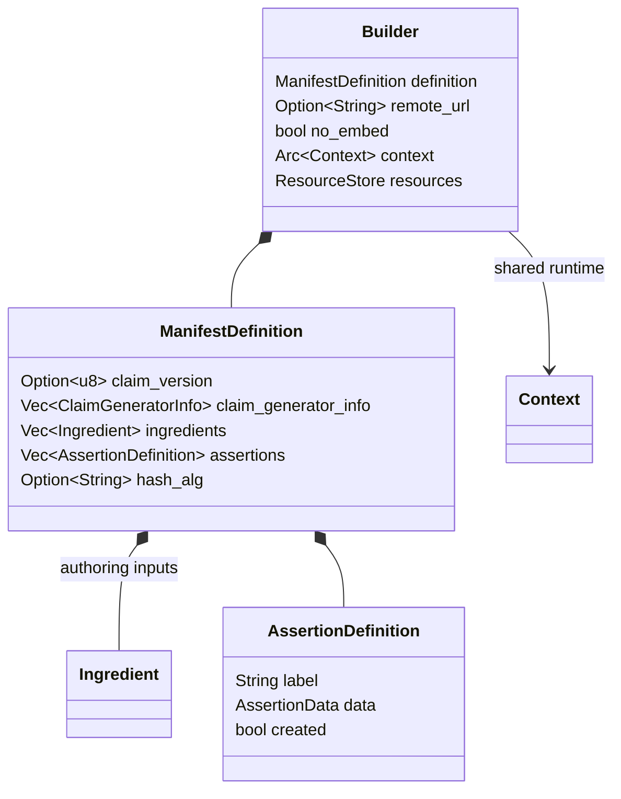
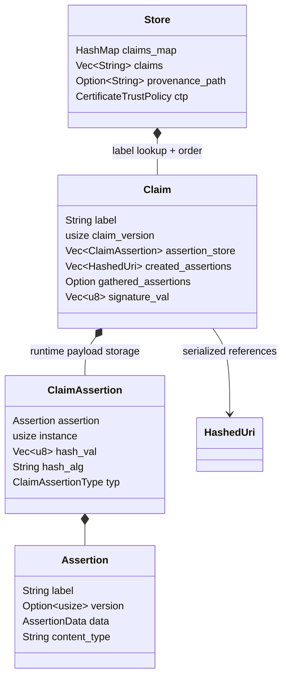
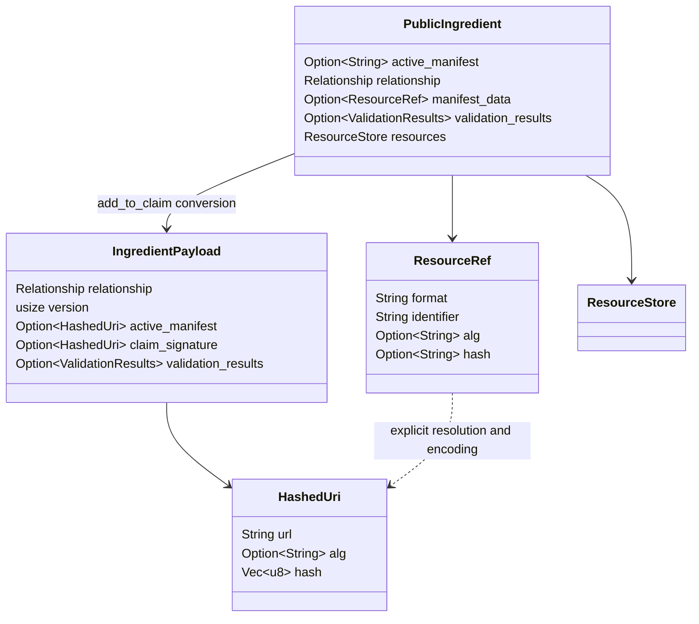
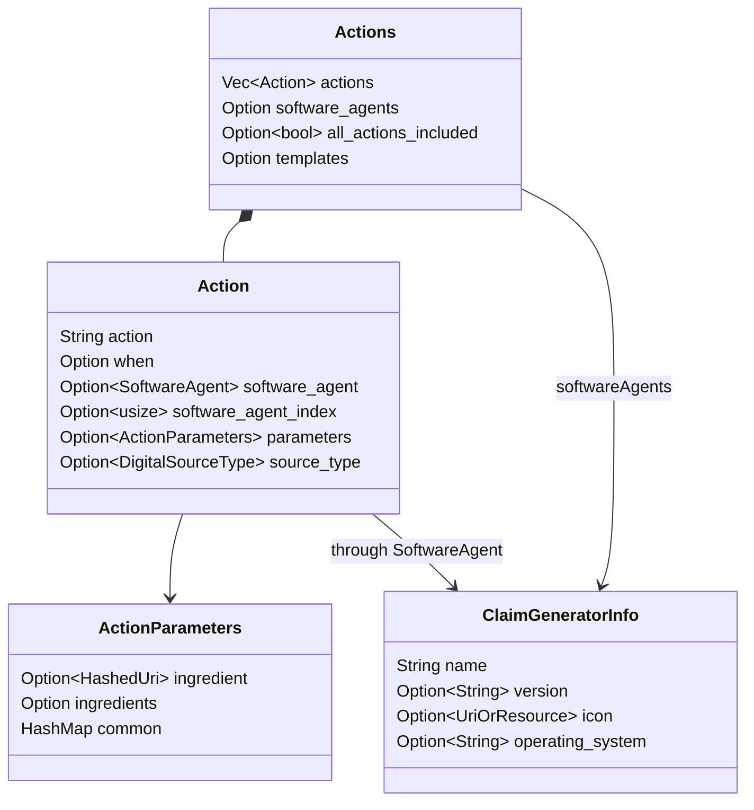
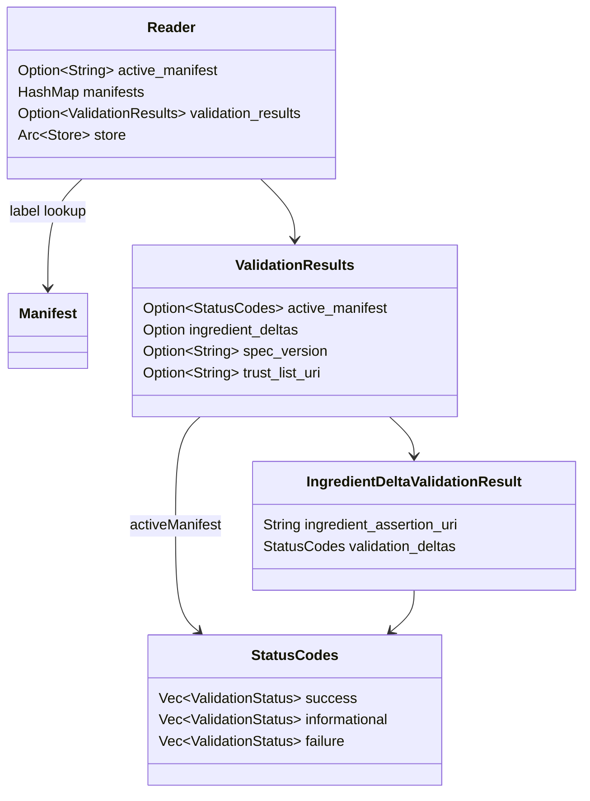

# Каталог типов: что держать в голове при чтении SDK

Основа: [модель C2PA](MODEL.ru.md), вход: [ONBOARDING.ru.md](../../ONBOARDING.ru.md). Snapshot: SHA `6c92bc322196b9b30be3599e62a363a63ab76b55`, workspace `0.92.0-dev`. Ниже точные имена типов и ключевые поля этого snapshot; diagrams сокращены и не являются полными Rust declarations или wire schemas.

[English version](TYPES.en.md).

## 1. Public API и authoring input

`Builder`, `ManifestDefinition`, `BuilderIntent` и `HashType` экспортируются из root crate. `AssertionDefinition` и authoring `AssertionData` определены в private `builder` module и не re-exported root API; их наличие как field type не означает доступность для прямого именования внешним Rust-кодом. Вход через JSON/`with_definition` и методы Builder проще и соответствует интерфейсу.

### ManifestDefinition: семантика полей

Источник: [builder.rs](../../sdk/src/builder.rs#L118).

| Поля | Rust type | Назначение |
|---|---|---|
| `claim_version` | `Option<u8>` | Версия claim, по умолчанию SDK строит v2 |
| `vendor`, `label` | `Option<String>` | Параметры manifest label; не assertion payload fields |
| `claim_generator_info` | `Vec<ClaimGeneratorInfo>` | Software identity; пустой список разрешается при build через settings/default |
| `title` | `Option<String>` | Отображаемое имя, не криптографический идентификатор |
| `format` | `String` | MIME, default `application/octet-stream` при десериализации definition |
| `instance_id` | `String` | Asset instance identifier; default генерируется как `xmp.iid:...` |
| `thumbnail` | `Option<ResourceRef>` | Ссылка на рабочий resource для дальнейшего преобразования |
| `ingredients` | `Vec<Ingredient>` | Public ingredient objects, участвующие в новой истории |
| `assertions` | `Vec<AssertionDefinition>` | Authoring assertions, ещё не claim references |
| `redactions` | `Option<Vec<String>>` | JUMBF URIs выбранных assertions в ingredient manifests |
| `metadata` | `Option<Vec<AssertionMetadata>>` | Legacy/не рекомендуемый путь metadata по комментарию SDK |
| `hash_alg` | `Option<String>` | Claim/assertion/asset hashing default; не signer algorithm |

Здесь перечислены input fields, не разрешения всех версий C2PA. Например, title/format присутствуют в authoring view даже когда соответствующий claim wire map использует другую структуру.

### BuilderIntent и HashType

Источник: [BuilderIntent](../../sdk/src/builder.rs#L352), [HashType](../../sdk/src/builder.rs#L72).

| Enum | Variants | Модель использования |
|---|---|---|
| `BuilderIntent` | `Create(DigitalSourceType)`, `Edit`, `Update` | Новое создание, редактирование родителя, restricted update без изменения hashed content |
| `HashType` | `Data`, `Bmff`, `Box` | Выбор механики embeddable hard binding; не тип signature algorithm |

Create не предполагает parent ingredient; Edit требует parent и может получить его из source stream; Update имеет более строгие ограничения. Проверки и автоматически создаваемые actions выполняет Builder. Это не Rust typestate: `set_intent` меняет runtime-поле и не делает неправильно настроенный input невозможным на этапе компиляции.

## 2. Runtime Store / Claim / Assertion

Источники: [Store](../../sdk/src/store.rs#L123), [Claim](../../sdk/src/claim.rs#L277), [ClaimAssertion](../../sdk/src/claim.rs#L151), [Assertion](../../sdk/src/assertion.rs#L226). Все эти owner modules private в root crate: `pub struct` внутри них не делает тип публичным внешнему потребителю.

- `Store.claims_map` обеспечивает lookup по label, `claims` сохраняет порядок. Caches box/signature hashes, trust policy и provenance path нужны runtime; это не JSON map всех полей стандарта.
- `Claim.assertion_store` содержит payload objects и hash bookkeeping; references в сериализованном claim - отдельные списки. `Claim.original_bytes` помогает использовать исходное representation, а не восстановленный JSON-view.
- `ClaimAssertion.instance` различает повторения одного assertion label; `typ` принимает `V1`, `Gathered`, `Created`. `hash_val` и `hash_alg` относятся к assertion reference, не к signature signer.
- `Assertion` хранит encoded payload, label, version и content type. Это envelope SDK; label не добавляется автоматически как field самого стандартизованного payload.

## 3. Три data representations, которые легко перепутать

| Тип и owner | Variants | На какой стадии находится data |
|---|---|---|
| `builder::AssertionData` | `Cbor(c2pa_cbor::Value)`, `Json(serde_json::Value)` | Authoring: структурированное значение до encoding |
| `assertion::AssertionData` | `Json(String)`, `Binary(Vec<u8>)`, `Cbor(Vec<u8>)`, `Uuid(String, Vec<u8>)` | Core: encoded payload и bytes |
| `manifest_assertion::ManifestData` | `Json(Value)`, `Cbor(CborValue)`, `Binary(Vec<u8>)` | Read/report view; разные методы доступа в зависимости от representation |

Источники: [authoring data](../../sdk/src/builder.rs#L235), [encoded data](../../sdk/src/assertion.rs#L183), [view data](../../sdk/src/manifest_assertion.rs#L27).

`AssertionDefinition` содержит `label`, `data`, optional `kind` и `created`. Входной JSON без explicit `kind` преобразуется в CBOR value. `ManifestAssertionKind` имеет `Cbor`, `Json`, `Binary`, `Uri`, но authoring JSON-deserializer `AssertionDefinition` разрешает Cbor/Json и отклоняет остальные branches. Четыре enum variants не означают четыре поддерживаемых способа добавить assertion через любой API.

[ManifestAssertion](../../sdk/src/manifest_assertion.rs#L37) - публичный labeled view: `label()`, `label_with_instance()`, `instance()`, `kind()`, `created()`, `value()`, `binary()`, `to_assertion<T>()`. `value()` может вернуть `UnsupportedType`, если data не JSON-view. `created` означает attribution к signer, а не «проверено» или «доверено».

## 4. Ingredient и ссылки на ресурсы

`PublicIngredient`/`IngredientPayload` - **псевдонимы только на диаграмме**, не новые Rust types. Реальные имена: [c2pa::Ingredient](../../sdk/src/ingredient.rs#L63) и [c2pa::assertions::Ingredient](../../sdk/src/assertions/ingredient.rs#L65).

Public Ingredient включает title/format, identifiers, relationship, source type, thumbnail/data/manifest_data refs, validation status/results и resource store. Payload содержит versioned hashed references и сериализуется через `serialize_v1/v2/v3`. В wire v3 `active_manifest` и `claim_signature` - `Option<HashedUri>`, а в public view active manifest - label string. Это разные representations, не конфликт типов.

`Relationship`: `ParentOf` → `parentOf`, `ComponentOf` → `componentOf` (default), `InputTo` → `inputTo`. Значение описывает роль ingredient относительно результата; не путать Rust enum spelling с serialized string и не называть все ingredients родителями.

`ResourceRef`: `format`, `identifier`, optional `data_types`, `alg`, `hash`; hash здесь `Option<String>`. `HashedUri`: `url`, optional `alg`, hash `Vec<u8>`; runtime salt не сериализуется. `ResourceStore` хранит bytes и optional lazy resolver; при file I/O учитывает base path и runtime containment root. Эти механизмы не являются самостоятельной проверкой происхождения.

Источники: [resource_store.rs](../../sdk/src/resource_store.rs#L119), [hashed_uri.rs](../../sdk/src/hashed_uri.rs#L29).

## 5. Typed payloads: actions и software identity

Источники: [Action](../../sdk/src/assertions/actions.rs#L486), [Actions](../../sdk/src/assertions/actions.rs#L959), [ClaimGeneratorInfo](../../sdk/src/claim_generator_info.rs#L28).

`Action.action` - label операции; `Actions` - assertion, содержащая список операций. Optional `when`, agent, changed regions, parameters, related actions и reason задают детали. Список не означает полной истории: `all_actions_included` - отдельное declaration, отсутствие которого не означает `true`.

`SoftwareAgent` может быть `String` или `ClaimGeneratorInfo` на уровне SDK; наличие обоих вариантов не отменяет ограничений конкретной actions schema version. В action parameters v1/v2 поля различаются: `ingredient` и `ingredients`, а описание в новых representations не следует без проверки помещать в старый nested field.

`ClaimGeneratorInfo` также содержит `spec_version` и extension map. Это заявленное описание generator, не certificate identity и не proof, что именно этот product выполнил операцию. `DigitalSourceType` описывает declared source category, например digital capture; это не результат независимого классификатора.

### Typed assertion families

| Семейство | Основные типы / источник | Зачем читать |
|---|---|---|
| История | [Action, Actions](../../sdk/src/assertions/actions.rs) | Операции, agents и references к ingredients |
| Участники | [Ingredient, Relationship](../../sdk/src/assertions/ingredient.rs) | Lineage и versioned links |
| Целостность | [DataHash](../../sdk/src/assertions/data_hash.rs), [BmffHash](../../sdk/src/assertions/bmff_hash.rs), [BoxHash](../../sdk/src/assertions/box_hash.rs) | Bytes/ranges, box structure, Merkle-related BMFF data |
| Поиск/устойчивые связи | [soft_binding.rs](../../sdk/src/assertions/soft_binding.rs) | Soft binding, не замена hard validation |
| Ресурсы и metadata | [embedded_data.rs](../../sdk/src/assertions/embedded_data.rs), [metadata.rs](../../sdk/src/assertions/metadata.rs), [assertion_metadata.rs](../../sdk/src/assertions/assertion_metadata.rs) | Binary content и дополнительное описание |
| Время/сертификаты | [timestamp.rs](../../sdk/src/assertions/timestamp.rs), [certificate_status.rs](../../sdk/src/assertions/certificate_status.rs) | Поддерживающие данные validation |

`AssertionBase` задаёт label/version и conversion; CBOR/JSON helpers кодируют typed structs. Общие traits определены в private [assertion.rs](../../sdk/src/assertion.rs#L103); конкретные публичные payload types доступны через `assertions` module.

### Binding payloads: поля и runtime

`DataHash` содержит `exclusions: Option<Vec<HashRange>>`, optional `name`/`alg`, hash/padding bytes; `path` исключается из serde. `BmffHash` содержит exclusions, optional alg/hash/name и Merkle maps; insertion points, cached UUID boxes и internal version - runtime, а не полный wire map.

Не вычислять binding самостоятельно по сокращённой таблице: выбранный формат, exclusions и placeholder/signing flow меняют покрытие bytes. `HashType::Bmff` не означает, что любой сегмент любого live protocol поддержан этим SHA.

## 6. Context, Settings и Signer

[Context](../../sdk/src/context.rs#L269) держит Settings, sync/async resolver state, signer state, progress callback, cancellation flag и IO handler registry. Builder/Reader могут разделять `Arc<Context>`. Это runtime configuration, не подписанная metadata asset.

[Signer](../../sdk/src/signer.rs#L49) предоставляет `sign(data)`, `alg()`, `certs()`, `reserve_size()`; есть optional timestamp/OCSP/dynamic assertion hooks. [AsyncSigner](../../sdk/src/signer.rs#L162) - отдельный async contract. Signer подключает способ подписи; trust policy Reader решает другой вопрос - доверять ли проверенному credential.

`SigningAlg` re-exported из crypto dependency; `SignatureInfo` в public Manifest - reporting summary. Не путать `reserve_size` с длиной asset hash; резерв нужен для размещения signature representation при build/embedding.

## 7. Read-side types и validation

Источники: [Reader](../../sdk/src/reader.rs#L93), [Manifest](../../sdk/src/manifest.rs#L53), [ValidationResults](../../sdk/src/validation_results.rs#L115), [StatusCodes](../../sdk/src/validation_results.rs#L62), [IngredientDeltaValidationResult](../../sdk/src/validation_results.rs#L662).

`Reader.active_manifest()` возвращает `Option<&Manifest>`, `manifests()` - карту label → Manifest. Это не обещание сортировки HashMap и не вся история в одном active object. `Manifest` предоставляет ingredients, assertions, resource refs, signature summary и version; `find_assertion<T>` возвращает typed payload из view.

`ValidationResults` сериализует camelCase keys `activeManifest`, `ingredientDeltas`, `specVersion`, `trustListUri`. Runtime validation time и timestamp trust list URI не сериализуются этим же representation. `ValidationStatus` предоставляет code и привязку к target/scope; группы success/informational/failure сохранять отдельно.

`ValidationState`: `Invalid`, `Valid`, `Trusted`. Это output SDK, не FSM, которую приложение может переводить в Trusted вручную. Критерии вычисляет [validation_state](../../sdk/src/validation_results.rs#L348). В частности, `Valid` может включать tolerated scoped failures; `Trusted` требует дополнительного trust success и отсутствия failures в учитываемых группах.

`Error`/`Result` - отдельный слой: невозможность завершить API call не следует представлять как обычный `ValidationStatus` успешного чтения. Точка входа: [error.rs](../../sdk/src/error.rs#L38).

## Шпаргалка выбора типа

| Задача | Начальный public API / понятие | Что не подменять |
|---|---|---|
| Прочитать и проверить asset | Context + Reader | `from_json` не вместо проверки bytes |
| Создать новую историю | Builder + ManifestDefinition + intent | Read-side Manifest не wire Claim |
| Добавить входной asset | Builder ingredient helper | Название файла не proof lineage |
| Прочитать actions | `Manifest::find_assertion<Actions>` | JSON envelope не typed schema любой версии |
| Получить binary resource | ResourceRef + Reader/resource resolver | URI не гарантирует наличие bytes |
| Подключить external signing | Signer / AsyncSigner | Signature algorithm не hash_alg |
| Показать результат в UI | ValidationResults + state + scopes | Один boolean не полная trust policy |